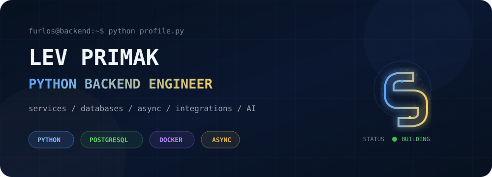

  

<h1 align="center">Lev Primak · Python Backend & AI Engineer</h1>

  Python · FastAPI · PostgreSQL · API integrations · Telegram automation · AI/LLM

  <a href="mailto:levprimak1007@gmail.com">Email</a> ·
  <a href="https://github.com/Furlos?tab=repositories">Repositories</a> ·
  <a href="https://github.com/Furlos">GitHub</a>

## About

I'm Lev, a Python developer studying **Computer Security at Immanuel Kant Baltic Federal University (BFU)**. I have around **three years of hands-on programming experience**.

My focus is backend development: APIs, databases, asynchronous integrations, automation and practical AI/LLM applications. I care about understandable architecture, reproducible setups, secure configuration and code that can be inspected rather than just described.

## Tech & tools

| Area | Technologies |
| --- | --- |
| Backend | Python, FastAPI, Django, REST APIs, asyncio |
| Data | PostgreSQL, SQL, SQLite |
| Integrations | HTTPX, Telegram bots, external APIs |
| AI | LLM integrations, local-model experiments |
| Infrastructure | Docker, Docker Compose, Linux, Git |

*Technologies listed here describe my broader hands-on areas; individual repositories document their own verified stacks.*

## Selected projects

### [Marzban Bot](https://github.com/Furlos/Marzban_bot) — Telegram and backend integration
A Telegram bot with a separate **FastAPI** backend integrating with the Marzban API. A useful example of separating a bot interface from HTTP services and external-system interactions.

**Explore:** Python · FastAPI · Aiogram · HTTPX · Docker

### [PostgreSQL OLAP Optimization](https://github.com/Furlos/vtb_optimization) — analytical SQL experiments
A Python/PostgreSQL experiment generating synthetic banking-style data and exploring indexes and materialized views for analytical queries.

**Explore:** PostgreSQL · SQL · BRIN/composite/partial indexes · materialized views

**Status:** benchmark correctness and reproducibility are being improved; performance claims should not be treated as independently validated results.

### [Alfabank AI Bot](https://github.com/Furlos/alfabank-AI-bot) — Telegram and AI services
An experimental Telegram AI assistant organized around a bot interface, a separate AI service and model integration.

**Explore:** Python · Telegram · AI/LLM integration · Docker Compose

### [Ruin Events](https://github.com/Furlos/ruin-events) — full-stack application
A project combining a **FastAPI** backend, **MongoDB** and a **React** frontend. Included as an additional example of working across API and client boundaries.

**Explore:** FastAPI · MongoDB · React

## What I'm working on

- Making existing projects easier to run, test and understand.
- Improving backend configuration, error handling and security hygiene.
- Exploring reliable AI integrations and data-intensive Python services.

## Engineering interests

**Backend architecture** · **SQL performance** · **API design** · **AI/LLM integration** · **Automation** · **Computer Security**

---

**Contact:** [levprimak1007@gmail.com](mailto:levprimak1007@gmail.com)

Projects are described according to their available source code. No production-scale, performance or commercial-impact claims are implied.
